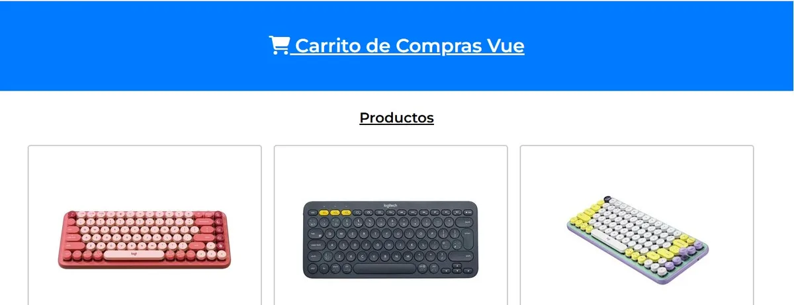

# 🛒 Carrito de Compras

Tienda online de periféricos con carrito de compras dinámico, construida con **Vue 3**. Los productos se cargan desde un archivo JSON y el carrito calcula cantidades y total en tiempo real.

  



---

## ✨ Funcionalidades

- Catálogo de productos cargado con `fetch` desde `productos.json`.
- Agregar y quitar productos del carrito.
- Cantidad total y precio total actualizados al instante.
- Precios formateados en pesos argentinos con `toLocaleString('es-AR')`.

## 🧠 Lo que practiqué

- Reactividad de Vue 3 (`data`, `methods`) usando Vue desde CDN, sin build.
- Consumo de datos JSON con `fetch` y promesas.
- Manejo de arrays (`map`, `push`, `splice`) y cálculo de totales.

## 🗂️ Estructura

```
├── index.html       Estructura y plantillas de Vue
├── carrito.js       Lógica de la app (Vue.createApp)
├── productos.json   Catálogo de productos
├── style.css        Estilos
└── imagenes/        Fotos de los productos
```

## ⚙️ Cómo verlo

Como los productos se cargan con `fetch`, la página tiene que servirse desde un servidor local:

```bash
npx serve .
```

También se puede usar la extensión **Live Server** de VS Code.

---

## 👤 Autor

**Benjamín Bosch**, desarrollador Full Stack · [GitHub](https://github.com/Benja391) · [LinkedIn](https://www.linkedin.com/in/benjamin-bosch-/)
